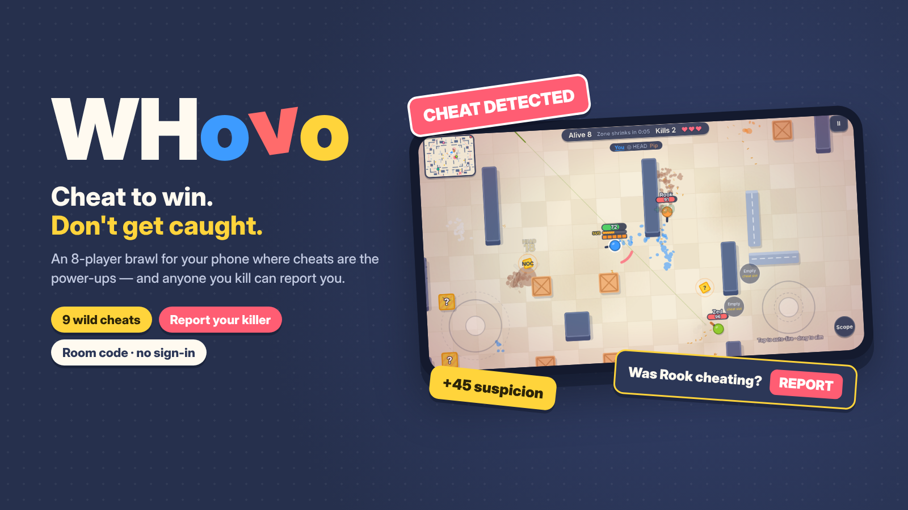

# WHovo — cheat to win, don't get caught

An 8-player brawl for phones and laptops where **cheats are the power-ups** — and anyone you kill can **report** you.

**Play:** open the GitHub Pages link for this repository. Tap *Play online* → *Create room*, then send friends the 4-letter code or the invite link. Nobody signs in or installs anything; empty seats are filled by bots. *Play vs bots* works solo.

## How it plays
- Every player is a candy-coloured ball; you are the blue one. Each player has 3 lives, the zone keeps closing, and the last player left wins.
- Break yellow “?” crates to find cheats (you can hold 2): ESP, Aimbot, Magic bullet, Hitbox, Blink, Speed, Noclip, Wallbang and Infinite ammo. Each one has its own signature trick.
- Cheating fills your **SUS** bar. At 100 you are banned for 10 seconds, everyone sees you, and your cheats switch off. You can switch a cheat off early with × to get some suspicion back.
- When someone kills you, you have 4 seconds to **report** them. What counts is whether they had a cheat on *at the moment they killed you*:
  - still running a fight-winning cheat (aimbot, magic, hitbox, wallbang, infinite ammo): their suspicion +45
  - still running a helper cheat (ESP, blink, speed, noclip): +28
  - switched it off right after the kill: +18 (helpers +12)
  - they were clean: the report fails and **you** lose a life
- Players who are behind on kills roll better cheats and gain suspicion more slowly, so weaker players can still compete with stronger ones.
- End-of-match awards: Cheat King, Detective, Paranoid, Caught Red-Handed and Squeaky Clean.
- The game is in English and Chinese; switch languages in Settings.

## How it works
- The whole game is a single `index.html` with no build step and no server code: Canvas 2D, synthesised Web Audio sound and touch twin-sticks.
- Online play is peer-to-peer WebRTC. The room creator's browser acts as the hub and runs the bots, crates, pickups and the match clock. Every other player is responsible for their own ball and judges reports made against it.
- Browsers find each other through the free public PeerJS signaling server; no data is stored anywhere. Add `?sig=wss://your-server/peerjs` to the URL to use your own PeerJS-compatible server.
